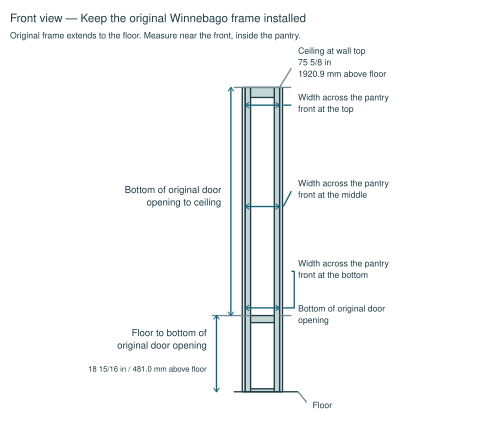
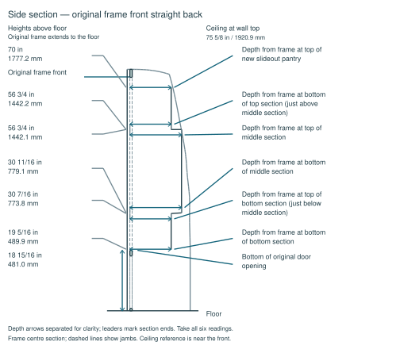
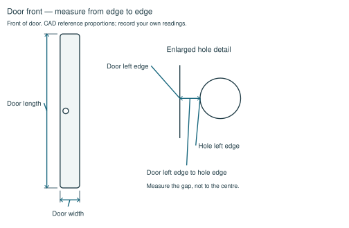

# Measure your Winnebago Revel pantry

Prefer to print it? Download the [PDF version](Winnebago-Revel-Pantry-Measurement-Instructions.pdf).

Help us check which Revel model years can use the [Brobston Creations slideout pantry](https://shop.brobstoncreations.com/winnebago-revel-slideout-pantry/).
The first complete submission for each model year earns a **10% off code**. See the Thank-you section for the full terms.
For this measurement stage, allow 45 minutes: 15 for access, 15 for fourteen readings and one photo, and 15 for reinstalling, filling the template and sending.
Stage 1 alone earns the code; a later test fit is expected in exchange.

## Tools

- **Tape measure**
- **Phillips screwdriver or a drill with a Phillips bit**
- **Phone for the photo**
- **Flashlight**
- **Pencil**

Use the screwdriver or drill only for removing and reinstalling screws: **no drilling**.

## Remove the factory internals

Leave the complete original Winnebago frame installed, with the door, hinges, latch and furring strips in place.
Keep each set of screws with its part and use the same screws when reinstalling.

1. Lift out the loose shelves, then unscrew the shelf supports that block access, including the back-left support at minimum.
2. The original fabric-covered rear wall and ceiling covering are one piece. Remove its screws on the left and right at the back, plus one ceiling screw nearest the frame. Release the attached fabric gently and lift the piece out to expose what is behind the original pantry back wall.

## Measure heights and widths

Use one unit throughout: millimeters, centimeters or inches. Record inches to the nearest 1/16 inch.
Use the actual surfaces in your van. Printed CAD heights are references; keep the tape straight and record each value under its matching name in the reply template below.



**Floor to bottom of original door opening**. Measure vertically from the floor to the bottom edge of the original pantry door opening (see the front view above), beside the frame where a straight tape path is accessible.

**Bottom of original door opening to ceiling**. From that same opening edge, measure vertically up to the top of the pantry walls near the front. Use this as the ceiling reference; disregard the ceiling shape farther back. Do not use the cabinet floor or a shelf as the starting point.

Measure all three widths inside left wall to inside right wall in the opening between the ceiling and the top of the bottom metal frame.
Use the existing bottom metal frame: its top edge is the bottom edge of the original pantry door opening.

**Width across the pantry front at the top**. Measure inside left wall to inside right wall just below the original frame head, above the bottom metal frame.

**Width across the pantry front at the middle**. Measure inside left wall to inside right wall halfway between the top and bottom width readings.

**Width across the pantry front at the bottom**. Measure inside left wall to inside right wall immediately above the top of the bottom metal frame.

## Measure depths

Start every depth at the front face of the installed original Winnebago frame and measure straight back to the first hard surface.
Keep the tape horizontal by eye and square to the front. Measure straight to the back.
The back of the new slideout pantry has a bottom section depth, a deeper middle section and a top section that is the same depth as the bottom section. Measure at both ends of each section: each end is a separate reading.
Use the six section-end heights shown in the side view to locate the readings in your van. Printed heights follow the new slideout pantry CAD panels; record horizontal depths, not heights.
Leave furring strips in place.
Take one value at each of the six heights below: measure straight back to the closest point of the back wall at that height. If the rear varies across the pantry, describe the variation in Notes.



The side section passes through the centres of the frame openings; dashed lines show the side jambs. Depth arrows are separated for clarity; their leaders mark the section ends. Take all six readings, even where two section ends share a height.

**Depth from frame at bottom of bottom section**. At the bottom edge of the new slideout pantry’s bottom section, at the height shown in the side view.

**Depth from frame at top of bottom section (just below middle section)**. At the upper end of the bottom section, immediately below the change to the deeper middle section.

**Depth from frame at bottom of middle section**. At the lower end of the middle section, immediately above that same change.

**Depth from frame at top of middle section**. At the upper end of the middle section, immediately below the change to the top section.

**Depth from frame at bottom of top section (just above middle section)**. At the lower end of the top section, immediately above that same change.

**Depth from frame at top of new slideout pantry**. At the top edge of the new slideout pantry’s top section, at the height shown in the side view.

## Measure the door

**Door left edge to hole edge**. Face the front of the door. At the height of the 2-inch hole's centre, measure horizontally from the door's straight left edge to the left (near) edge of the circular hole, not its centre. Keep the door, hinges and latch installed; open the door if needed to reach its edges.
If the latch hides the hole edge, explain it in Notes.

**Door length**. Measure vertically from the top edge to the bottom edge of the door itself, along a straight side.

**Door width**. Measure horizontally from the left edge to the right edge of the door itself, across its straight sides.

Measure the door itself, not the frame or opening. Use the same units as the other readings. All three door readings are required; if an edge is inaccessible, explain it in Notes. The submission is incomplete until all three can be measured safely. Do not guess from the drawing.



## Take one photo

Take one landscape photo showing what is behind the original pantry back wall so we can spot obstructions.
Light the back corners with the flashlight and use the phone flash if needed. Frame the exposed area from the floor to the ceiling, including anything projecting from the van wall.
If the covering could not be removed safely, take the one photo of the accessible view and explain the hidden area in Notes.
Before sending, crop or cover personal details and remove location information saved in the photo file. Check that any album link hides your name and location.

## Reinstall

Reverse the removal order: replace the one-piece fabric covering, shelf supports and loose shelves with their original screws.
Check that everything is secure and the door closes normally.

## Fill the reply template

Copy this block into your email; use Yes, Maybe or Just helping for Buy intent, mm, cm or in for Units, YYYY-MM-DD for Measured date, and Notes for unavailable readings.

```text
Model year:
Floorplan:
Buy intent:
Units:
Measured date:
Floor to bottom of original door opening:
Bottom of original door opening to ceiling:
Width across the pantry front at the top:
Width across the pantry front at the middle:
Width across the pantry front at the bottom:
Depth from frame at bottom of bottom section:
Depth from frame at top of bottom section (just below middle section):
Depth from frame at bottom of middle section:
Depth from frame at top of middle section:
Depth from frame at bottom of top section (just above middle section):
Depth from frame at top of new slideout pantry:
Door left edge to hole edge:
Door length:
Door width:
Photo behind the original pantry back wall:
Notes:
```

## Send it

Email tony@brobstoncreations.com with the subject `Revel Pantry Measurements – [year] [floorplan]`.
Include the completed template and the one photo as an attachment or an album link.
The data is shared publicly, anonymized; we remove identifying details before publishing it.

## Thank-you: 10% off

Thanks for helping us get the fit right! We offer one 10% off code per model year, for the first complete submission.
Tony confirms your submission and sends a single-use code.
The code is honored on a deposit or an order, with no expiry while the program is open.

When your year's unit is ready, test fit means installing it per the instructions and sending a short fit report.
If your year needs a design change, your deposit is refunded or held, at your choice.
